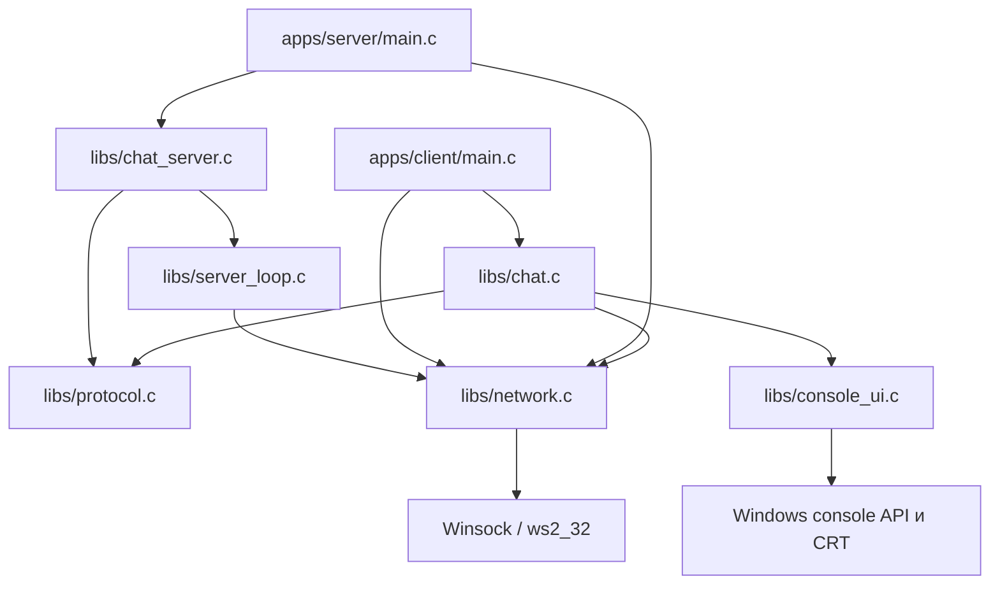
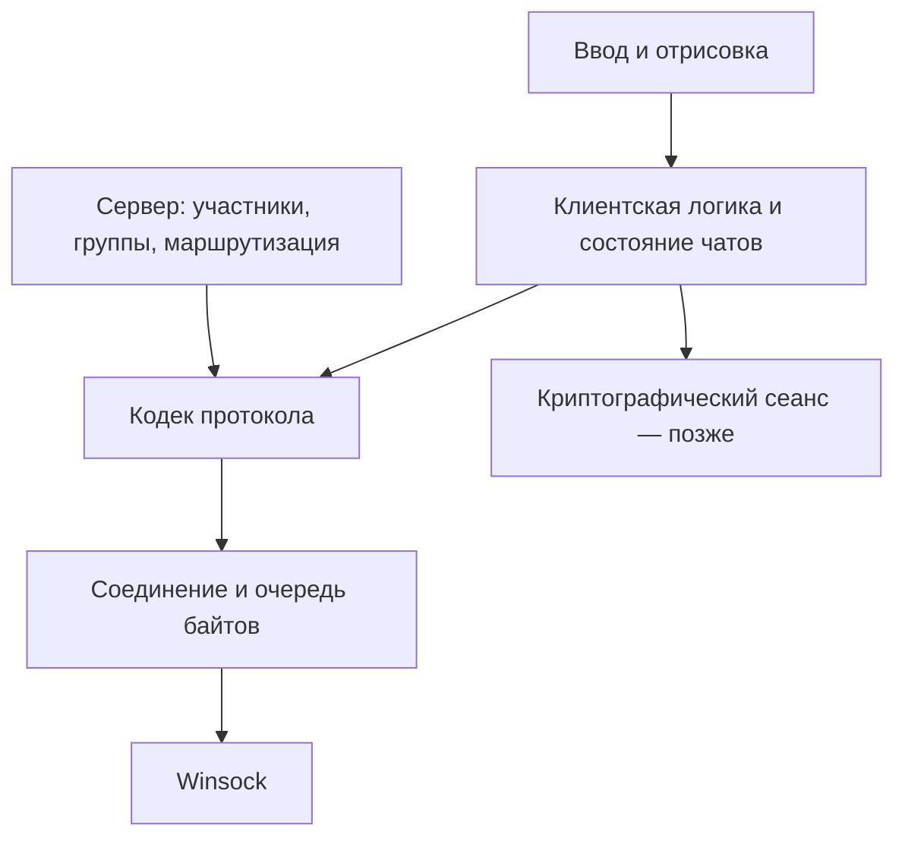
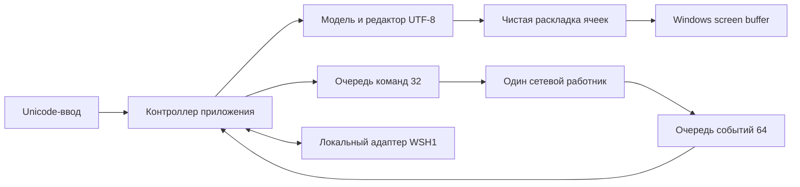

# Архитектура TermTalk: устройство и обоснование

Статус: описание работающей базы и проект следующих этапов для совместного разбора. Разделы «Сейчас» описывают код; разделы «Целевая модель» — предложения, ещё не реализованные полностью. В 0.6.0 реализованы WSCK v2, регистрация, личные сообщения, меню серверов, статус и файлы; ёмкость 1..32 участника. Группы и шифрование ещё не реализованы. Исторические разделы 0.3–0.5 описывают развитие; текущие дополнения — раздел 15.

## 1. Что означает архитектура

Архитектура определяет, где находятся данные, кто может их менять, как взаимодействуют части программы и какие свойства мы гарантируем. Разбиение на файлы — только внешнее выражение этих решений. Если любой файл может менять любой глобальный объект, логического разделения почти нет, даже при большом количестве каталогов.

Для нашего проекта важны три свойства:

- Высокая связность внутри модуля: его функции решают близкую задачу, например управление соединением.
- Низкая связанность между модулями: изменение расположения консольных областей не меняет сетевой код.
- Сокрытие деталей: вызывающая сторона знает контракт операции, но не обязана знать устройство её буфера.

Это инженерные ориентиры, а не абсолютные правила. Слишком много мелких абстракций тоже усложняет сопровождение. Разделяем обязанности там, где отличаются данные, причины изменений и способы проверки.

Пример: изменение цвета сообщения относится к UI; изменение порядка байтов длины — к протоколу; запрет отправки постороннему участнику — к логике сервера. Функция, одновременно решающая все три вопроса, создаёт ненужные зависимости.

## 2. Сейчас: какие модули действительно работают



Стрелка здесь означает зависимость вызовов. Клиент и сервер — разные процессы; общая библиотека даёт каждому собственную копию состояния. Их глобальные переменные не являются общей памятью.

| Модуль | Его обязанность сейчас | Чего он не должен решать |
|---|---|---|
| `main_client.c` | Разобрать IP/порт, запустить Winsock, соединение и сеанс, освободить ресурсы | Рисовать экран или реализовывать отправку |
| `main_server.c` | Создать ChatServer, обработать остановку | Разбирать команды и вести реестр участников |
| `chat_server.*` | Регистрация, ID, никнеймы, снимки списка и личная маршрутизация | Рисовать UI или закрывать чужие сокеты напрямую |
| `protocol.*` | Заголовки, UTF-8, длины, накопление и синтаксис payload | Выбирать адресата или проверять права |
| `server_loop.*` | Владеть listener и десятью соединениями, ждать готовности, ограничивать очередь и время ожидания | Определять никнеймы, права и границы кадров |
| `network.*` | Работа с сокетами и байтами, ограниченный буфер отправки | Никнеймы, команды чата, отрисовка |
| `chat.*` | Клиентский HELLO, список и выбор участника, команды, RX/TX и завершение | Представлять окончательную модель UI с историей |
| `console_ui.*` | Читать ввод, выводить текст и сохранять режим консоли | Вызывать `send`, определять адресата или хранить ключи |

`Parse_Port` временно находится в `network.c`: при появлении полноценной конфигурации его можно перенести в отдельный модуль. Название `winsock_console` в CMake пока объединяет UI и сеанс; это группировка сборки, а не окончательная граница приложения.

Сервер 0.4.0 разбирает кадры отдельно для каждого соединения и передаёт личное сообщение только указанному зарегистрированному адресату. Прежняя рассылка сырых байтов остаётся транспортным helper, но приложение её больше не вызывает.

## 3. Контракт, инварианты и владение в C

Контракт функции состоит из предусловий, результата, побочных эффектов и поведения при ошибке. Например, вызывающий передаёт инициализированное соединение и доступный буфер, а функция либо принимает все байты в очередь, либо возвращает ошибку, не добавив часть сообщения.

Инвариант — условие, которое должно сохраняться после каждой корректно завершённой операции. Для текущей отправки:

```text
0 <= client.tx_size <= NETWORK_TX_CAPACITY
tx_buffer[0 .. tx_size) — байты, ещё не переданные через send
```

Если `send` принял 3 байта из 8, остаётся 5. Сдвиг выполняется от старого начала плюс 3, а не плюс 5. `memmove` допускает перекрытие областей. Позже, если измерения покажут существенную стоимость сдвигов, можно хранить смещение или использовать кольцевой буфер. Сначала обеспечиваем правильность.

В C владение — соглашение между разработчиками: язык не закрывает сокет автоматически при выходе из области видимости.

| Ресурс | Владелец сейчас | Завершение жизни |
|---|---|---|
| Инициализация Winsock | `main` процесса | Один `Network_Cleanup` после успешного `Network_Initialize` |
| Слушающий сокет | `ServerLoop`, которым владеет основной поток сервера | `ServerLoop_Destroy`; при ошибке создания — внутренняя очистка |
| Сокет клиента и буферы | На клиенте — `main`; на сервере — слот `ServerLoop` | На клиенте после потоков; на сервере при отключении или Destroy |
| Очередь отправки | Поток отправки | Другой поток её не меняет |
| Событие остановки и дескрипторы потоков | `Chat_Run` | После окончания работающих потоков |
| Режим консоли и блокировка вывода | `console_ui.c` | `Console_Cleanup` после окончания потоков |

Владение ресурсом не тождественно использованию: поток приёма использует сокет, но не закрывает его. После закрытия дескриптор Windows может быть переиспользован; закрытие «из другого места на всякий случай» создаёт трудноуловимые ошибки.

Структура `Client` сейчас фактически описывает соединение. Позже предлагается имя `Connection`, а данные человека и сеанса — отдельные `Participant` и `Session`. IP-адрес — адрес подключения, не постоянная личность пользователя. Никнейм также не является доказательством личности.

`ip_connected` теперь массив внутри структуры: адрес копируется, поэтому объект не зависит от времени жизни строки аргумента. `rx_buffer` и `rx_size` сохранены после рефакторинга, но текущий приём использует локальный буфер; накопитель кадров теперь хранится отдельно в ProtocolDecoder у прикладного сеанса.

## 4. Как читать результаты сетевых функций

| Функция | Результат | Что это означает |
|---|---|---|
| `Socket_Send` | `0` | Все байты скопированы в локальную очередь |
| `Socket_Send` | `SOCKET_QUEUE_FULL` (`-3`) | Очередь приложения заполнена; данные не добавлены, соединение сохранено |
| `Socket_Send` | `-1` | Неверные параметры или состояние; посмотреть `WSAGetLastError` |
| `Socket_Flush` | `0` | В локальной очереди ничего не осталось |
| `Socket_Flush` | `1` | Есть остаток, нужно снова дождаться готовности сокета |
| `Socket_Flush` | `-1` | Ошибка; текущий сеанс завершается |
| `Socket_Recv` | `> 0` | Число полученных байтов |
| `Socket_Recv` | `0` | Собеседник завершил отправку, доступные данные прочитаны |
| `Socket_Recv` | `-2` | Пока нет данных, ждать следующей готовности |
| `Socket_Recv` | `-1` | Ошибка |

`WSAEWOULDBLOCK` — ожидаемое состояние неблокирующего сокета. Это не разрыв связи. Код ошибки получают после неудачной операции, до других вызовов, способных его изменить. При очистке после ошибки соединения исходный код ошибки сохраняется и восстанавливается.

Успешный `send` не подтверждает обработку сообщения программой получателя. Отдельно различаем локальную очередь, передачу транспорту, принятие сервером и подтверждение клиентом. См. [семантику send](https://learn.microsoft.com/en-us/windows/win32/api/winsock2/nf-winsock2-send) и [recv](https://learn.microsoft.com/en-us/windows/win32/api/winsock2/nf-winsock2-recv).

## 5. Сейчас: конкурентное выполнение

`Chat_Run` на стороне клиента создаёт два потока. Один получает текст от локального ввода и владеет отправкой, другой принимает байты. Главный поток ждёт обоих и затем освобождает общие ресурсы.

```mermaid
sequenceDiagram
    participant M as main / Chat_Run
    participant T as Поток отправки
    participant R as Поток приёма
    participant P as Собеседник
    M->>T: Запуск с общим stop_event
    M->>R: Запуск с общим stop_event
    T->>T: Ввод → очередь → ожидание writable
    T->>P: send части очереди
    P->>R: Байты или завершение отправки
    R->>R: Отобразить байты; при EOF установить событие
    T->>T: Увидеть событие и завершиться
    M->>M: Дождаться потоков → закрыть ресурсы
```

Конкурентность означает несколько незавершённых действий; параллельность — их физическое одновременное выполнение. Сеть и ввод требуют конкурентности даже на одном процессорном ядре.

Критическая секция защищает составные операции вывода: перевод курсора, запись текста и восстановление позиции должны восприниматься как одна операция. Она не хранит историю чата и не гарантирует правильную геометрию при длинных строках. `stop_event` сообщает обоим потокам о завершении. `Interlocked` обеспечивает синхронизированный доступ к флагу ошибки; одного `volatile` для межпоточной синхронизации недостаточно.

Отправка и приём используют `select` с ожиданием до 100 мс. Ожидание ввода проверяет остановку с интервалом до 20 мс. Это ограниченный по времени опрос, а не постоянное вращение пустого цикла; значения остаются инженерным компромиссом по задержке и числу пробуждений.

EOF stdin выполняет `shutdown(SD_SEND)` и позволяет получить ответ. Входящий TCP EOF в текущем сеансе останавливает и локальный ввод. Это выбранная политика приложения, а не обязательное правило TCP. `/quit` немедленно останавливает сеанс; гарантированная доставка всех последних байтов при таком выходе не обещана.

## 6. Целевая модель: отделение смысла от транспорта



Входящий путь проходит обратно по слоям: транспорт сообщает байты, кодек извлекает кадры, приложение проверяет допустимость события и обновляет состояние, UI отображает результат. Исходящий путь начинается с намерения пользователя: «отправить текст участнику 7», а не с готового вызова `send`.

Предлагаемые обязанности:

| Компонент | Данные и операции | Граница |
|---|---|---|
| `net` | Сокеты, адреса, RX/TX-буферы, готовность, закрытие | Не понимает содержание кадров |
| `protocol` | Поля кадра, длины, типы, сериализация и синтаксические проверки | Не ищет адресата и не рисует текст |
| `server_app` | Реестр соединений, ID, членство в группах, права и маршрутизация | Получает структурированные команды |
| `client_app` | Выбранный чат, участники, локальная история, статусы сообщений | Не зависит от координат консоли |
| `ui` | События клавиатуры, раскладка, перерисовка изменившихся участков | Не владеет сокетом |
| `transfer` — позже | Согласие на файл, блоки, прогресс, отмена, завершение | Использует протокол, не подменяет чат своим циклом отправки |
| `crypto` — позже | Алгоритмы и управление криптографическим сеансом | Ключи расшифрования содержимого остаются у клиентов |

Чистые правила приложения желательно выражать обычными структурами C. Зависимости от Windows оставляем в адаптерах ввода-вывода и синхронизации. Это облегчает проверку, даже если переносимость на другую ОС сейчас не требуется.

## 7. Почему сначала цикл событий на сервере

Два потока клиента остаются временной схемой до UI-этапа. Сервер имеет одного владельца десяти TCP-соединений; в 0.4.0 callback ChatServer разбирает кадры и выполняет регистрацию и маршрутизацию:

```text
собрать read-набор и write-набор только непустых очередей
дождаться готовности или ближайшего таймера
принять подключения с установленным лимитом
прочитать доступные байты в пределах бюджета соединения
передать фрагменты callback приложения, поставить байты в очереди
выделить кадры, проверить прикладное состояние и адресата
частично отправить готовые очереди
обработать ошибки, таймеры и закрытия
```

Такой подход часто называют Reactor: приложение ждёт готовности ресурса и само выполняет операцию. В модели завершений приложение заранее запускает операцию и получает уведомление о результате; IOCP относится к этому направлению. IOCP даёт другие возможности, но требует более сложного управления временем жизни операций и буферов. Его необходимость будем обосновывать измерениями.

`select` не делает алгоритм автоматически эффективным: если всегда включать все сокеты в write-набор, большинство постоянно готовы, и цикл может вращаться без полезной работы. Если бесконечно обслуживать самого активного клиента, остальные будут ждать. Поэтому нужны ограничение работы за проход и контроль очередей.

В Winsock размер `fd_set` по умолчанию ограничен `FD_SETSIZE = 64`; это не обещание работы сотни клиентов. Для первого лимита 10 места достаточно с учётом слушающего сокета. Перед ростом нужно пересмотреть ограничения и механизм ожидания, а не только увеличить массив. См. [select](https://learn.microsoft.com/en-us/windows/win32/api/winsock2/nf-winsock2-select).

Для клиента целевая схема — один владелец UI и отдельный сетевой цикл с ограниченными очередями команд/событий. Результат приёма превращается в событие, а не в прямую печать из сетевого потока. Сейчас это ещё не реализовано. Windows `select` работает с сокетами, поэтому консольный ввод нельзя просто добавить к нему как Unix stdin.

## 8. Ограниченные ресурсы и обратное давление

Если получатель медленнее отправителей, данные накапливаются. Неограниченная очередь переносит проблему из сети в память и в конце приводит к отказу процесса. Обратное давление означает явное ограничение накопления и реакцию на его достижение.

В текущем коде очередь TX на 64 КиБ отклоняет добавление целиком с `SOCKET_QUEUE_FULL`. Системный `WSAENOBUFS` обозначает отдельную проблему ресурсов Winsock. В ServerLoop не более десяти очередей по 64 КиБ (640 КиБ полезных TX-данных). При переполнении или отсутствии прогресса 5 секунд отключается получатель. В 0.4.0 личная отправка предварительно проверяет очереди адресата и отправителя; при нехватке места возвращает QUEUE_FULL без постановки события. Автоматические снимки списка при невозможности отправки переводят отставший сеанс в завершение. Файлы передаются блоками с ограничением числа блоков в очереди; весь файл не помещается в один сетевой буфер.

Реестр выделяется в куче, чтобы не занимать стек десятью крупными объектами Client. Системные буферы сокетов и метаданные учитываются отдельно от 640 КиБ TX.

## 9. Как растёт интерфейс

Сейчас экран хранится в самой консоли: после перехода к следующей строке старое содержимое не является моделью чата. Целевая модель хранит сообщения отдельно и строит отображение из состояния, размеров окна и позиции прокрутки.

Можно хранить предыдущее и новое представления и обновлять изменившиеся области. Это уменьшает лишние записи и мерцание, но требует правильной обработки переноса текста и изменения размера окна. Байт, Unicode-кодовая точка и ширина символа в ячейках — разные величины; поддержка русского текста не решается одним увеличением буфера.

Данные из сети не должны исполняться терминалом как управляющие последовательности: будущий UI будет фильтровать управляющие символы и применять собственное оформление. Файловые имена и пути также рассматриваются как входные данные, а не готовые команды или разрешённые пути.

## 10. Как проверяем архитектуру на практике

Проверки строим по границам ответственности: буферы и кодек — детерминированные модульные тесты; сетевой сеанс — реальные loopback-соединения; интерфейс — работа в целевых терминалах; сервер — несколько клиентов, медленный получатель, повреждённый ввод и разрыв связи.

Текущие восемь проверок описаны в BUILD-VERIFICATION.md. Частичные отправки проверяются управляемой подменой только в тестовой цели; отдельный тест заполняет настоящий TCP-буфер. Они не доказывают правильность всех расписаний потоков или UI. Успешная сборка проверяет согласованность кода с компилятором и линковщиком, а не выполнение всего ТЗ.

Порядок следующего разбора: контракт соединения → частичные операции → кодек протокола → реестр клиентов и маршрутизация → модель состояния клиента → отрисовка. Конкретный формат обмена и примеры байтов находятся в [PROTOCOL.md](PROTOCOL.md).

## Вопросы для самопроверки

1. Почему `Client_Close` вызывается после ожидания потоков?
2. Почему успешный `Socket_Send` ещё не означает отправку по сети?
3. Кто должен отклонить сообщение несуществующему адресату: транспорт, кодек или серверная логика?
4. Что произойдёт с памятью сервера, если медленному получателю бесконечно добавлять файлы в очередь?
5. Почему замена консоли на другой интерфейс не должна менять формат сетевого кадра?

## 11. Контракт NET-01: состояния, владение и ошибки (2026-10-20)

Объект `Client` создаётся с `CLIENT_INITIALIZER`. После успешной инициализации
вызвавший код получает единственное владение сокетом; `accept` создаёт отдельный
сокет, независимый от слушающего. При неудаче создания модуль освобождает созданные
им ресурсы, сохраняя исходный код ошибки. Повторная инициализация живого объекта
отклоняется и не теряет его дескриптор. Не копируем объект с открытым сокетом.

Использование сокета может быть заимствовано обработчиками. Только владелец
вызывает `Client_Close` после завершения всех заимствований. Это контракт API,
а не проверка ID потока. Передача владения требует прекращения использования
прежним владельцем; отдельной операции передачи сейчас нет. Закрытие отбрасывает
остаток очереди; для завершения с отправкой остатка сначала требуется drain.

| Состояние | Разрешённые операции |
|---|---|
| `CLOSED` | Инициализация, повторное закрытие |
| `CONNECTING` | Внутренний этап неблокирующего connect с ограниченным ожиданием; параллельный доступ запрещён |
| `OPEN` | Приём, добавление в очередь, отправка, начало завершения |
| `DRAINING` | Приём и отправка остатка; новые данные запрещены |
| `SEND_CLOSED` | Только приём; повтор ShutdownSend допустим |
| `FAILED` | Завершение пользователей объекта и закрытие владельцем |

`Client_BeginDrain` запрещает добавление данных. После опустошения очереди
`Client_ShutdownSend` вызывает shutdown(SD_SEND). Преждевременный shutdown
отклоняется без потери очереди. Состояние читается через `Client_GetState`.
Входящий EOF хранится отдельно и читается через `Client_HasPeerEOF`: он не запрещает
отправку. Это состояние транспорта, а не регистрация пользователя протоколом.

Текущий Chat_Run пока использует два потока. Состояние и EOF синхронизированы через
Interlocked; TX имеет одного владельца, RX — другого. Закрытие и начальная настройка
не выполняются параллельно с ними. Системная ошибка send/recv переводит объект в
FAILED без закрытия; уже начатая другая операция может завершиться позднее.
Сам select пока обрабатывается сеансом: его ошибка завершает сеанс. Временная
неготовность сокета не переводит его в FAILED. Ошибки аргументов и состояния
также не разрушают объект. Политика Chat_Run при входящем EOF по-прежнему
останавливает сеанс; транспорт позволяет иную политику в будущих приложениях.

`NetworkError` различает ожидание, отказ, недоступность, тайм-аут, прерывание,
локальную и прочую системную ошибку. `NetworkLocalError` отдельно описывает
аргументы, состояние, занятый/недоступный адрес, доступ, ресурсы и инициализацию.
Классификация не заменяет исходный код и контекст вызова. Вызывающий сохраняет
WSAGetLastError немедленно; WSAStartup возвращает код напрямую. Диагностика
клиента, сервера и сеанса показывает причину и исходное число. Повтор подключения
автоматически не выполняется. Ошибка настройки прекращает запуск с освобождением
ресурсов; ошибка сеанса останавливает его. Неизвестные коды не скрываются.

В 0.3.0 очередь остаётся фиксированным массивом на 64 КиБ с memmove. `SOCKET_QUEUE_FULL` не требует
чтения WSAGetLastError. Временный интерфейс сообщает отказ постановки и продолжает
сеанс. Буфер источника копируется; дальнейшее изменение источника безопасно.
Кольцевой буфер можно добавить позже за теми же операциями. В 0.4.0 максимальный реализованный кадр — 4120 байт: он целиком помещается в TX. ProtocolDecoder собирает его из фрагментов RX по 1024 байта. Прежний проектный резерв payload 65536 не реализуется без отдельных будущих команд.

Для будущего NET-03 согласован один сетевой поток сервера. Сервер по-прежнему
проверяет команды и маршрутизирует данные; файловые операции клиента и шифрование
не должны блокировать сетевой цикл. Этот цикл реализован в 0.3.0; подробности ниже.

## 12. Транспорт, введённый в 0.3.0 и сохранённый в 0.4.0

Server_Listen создаёт неблокирующий listener без accept; Server_Accept выполняет
ровно одну попытку, возвращая 1 при ожидании. Прежняя блокирующая функция
Server_Initialize удалена. ServerLoop_Create получает владение listener и реестром;
ServerLoop_Destroy закрывает всё, даже если клиенты остались активными.

Один Poll строит снимок read/write-наборов, проверяет таймеры и ждёт через select.
Сначала обслуживаются готовые TX, затем один recv на клиента и callback. Порядок
слотов циклически сдвигается; accept выполняется в конце и ограничен десятью
попытками. Так новый дескриптор не использует флаги старого закрытого HANDLE.
Лишнее подключение снимается из backlog и закрывается без изменения активных слотов.
Ошибка одного клиента не останавливает остальных. Ошибка listener/select возвращается
вызывающему; приложение завершает цикл с очисткой, не повторяет ошибку пустым циклом.

Callback получает только заимствованный фрагмент и Client*. Запрещено сохранять
указатели на фрагмент/соединение, закрывать заимствованный сокет или рекурсивно
вызывать Poll/Destroy. Тяжёлая обработка не выполняется в callback. Реестр и
счётчики читаются только владельцем. Broadcast копирует данные в отдельные очереди.
Переполнение закрывает только получателя: пропуск фрагмента нарушил бы целостность
его потока. Таймер без прогресса TX — 5 секунд; таймер drain после EOF — 3 секунды.
Poll принимает ожидание 1..1000 мс, приложение использует 100 мс. Таймеры наблюдаются
на границах проходов, поэтому это не жёсткие сроки реального времени.

Входящий EOF переводит слот в DRAINING: ранее полученные байты уже переданы callback,
новые исходящие данные больше не добавляются; существующая очередь отправляется
в пределах срока и соединение закрывается. Остановка сервера немедленно закрывает
все сокеты, не обещая доставку остатка. Ctrl+C/Ctrl+Break только устанавливают атомарный
флаг; ресурсы закрывает главный поток. Принудительное завершение процесса в тестах
не считается проверкой консольного обработчика; очистка реестра проверяется C-тестом.

В 0.3.0 демонстрационный callback main_server пересылал байты всем, кроме источника; в 0.4.0 его заменил ChatServer.
Сервер не читает stdin и не печатает каждый сетевой фрагмент: перенаправленный вывод
не должен блокировать обработку трафика. Групповые права остаются будущей задачей; реализованные бинарный протокол и личная маршрутизация описаны ниже.

## 13. Личный чат 0.4.0: кодек, сеанс и модель клиента

ChatServer владеет ServerLoop и десятью ChatPeer. Отдельный ProtocolDecoder каждого
ChatPeer не смешивает потоки разных соединений. Lifecycle OPEN создаёт прикладной
сеанс, CLOSE отзывает Client* до повторного использования транспортного слота.
Приложение освобождается после ServerLoop_Destroy и его последних уведомлений.
Транспорт не знает содержимого команд, кодек не ищет адресата, маршрутизатор не рисует UI.

Приложение различает ожидание HELLO, активную регистрацию и завершение независимо
от ClientState. ID выдаётся монотонно, занятые никнеймы сравниваются по UTF-8 байтам.
Повторное подключение создаёт новый ID. Список передаётся целым снимком с IP, портом
и статусом online; отключённый участник исчезает из снимка, а не остаётся записью
с прежним ID. Снимок с request=0 — уведомление об изменении, ненулевой ID — ответ
на LIST_REQUEST. При исключении перегруженного сеанса следующий проход уточняет
снимок для оставшихся участников.

Личная отправка отделяет recipient ID от текста. Sender ID берётся из ChatPeer.
Заранее проверяется вместимость двух очередей — CHAT_EVENT адресату и ACCEPTED
отправителю. Между проверкой и постановкой нет другого владельца или системного
send, поэтому целые кадры добавляются без промежуточной потери места. Ошибка
адресата или переполнение не превращаются в отправку части сообщения. ACCEPTED
не подтверждает получение приложением; при разрыве результат может остаться неизвестен.

Исторический клиент 0.4.0 сохранял модель списка независимо от её печати. RX заменял снимок под
model_lock, TX читает его при /to и выборе получателя обычного текста. Исчезновение
выбранного ID сбрасывает выбор. Только RX владеет ProtocolDecoder и признаком
полученного WELCOME, только TX — очередью и счётчиком запросов. Ready event не даёт
вводить команды до регистрации, stop event завершает обоих. Ни одно ожидание потока
не выполняется с удержанием model_lock. Вывод по-прежнему защищён модулем console_ui;
полная модель истории и единственный владелец отрисовки остаются UI-01.

Этот клиентский порядок заменён в 0.5.0 устройством следующего раздела;
сетевой формат и серверный ChatServer при этом не изменились.

Протокол проверяет скаляры UTF-8 и запрещает NUL, ESC, остальные C0 кроме TAB/LF в
тексте, DEL и C1. Явный никнейм клиента переводится из Unicode-командной строки Windows
в UTF-8. Это не обещает идеального ручного ввода/геометрии Unicode во всех терминалах.
Криптографическая аутентификация и E2EE пока отсутствуют; сервер видит текст.

На сборку неполного кадра и регистрацию отводится по 10 секунд. Таймер кадра
начинается с первого байта и не продлевается медленной передачей. Произвольный
сетевой размер не выделяет память: предел payload — 4104, накопитель — 4120 байт.
В UI текст ограничен 4096 UTF-8 байтами; команды имеют небольшой отдельный запас.

## 14. Клиент 0.5.0: владелец состояния и заменяемые адаптеры

Основной поток `Chat_Run` владеет Client, UiModel, ConsoleUi и HistoryStore.
Только он меняет модель и рисует экран. `main_client` разбирает Unicode-аргументы;
контроллер создаёт Winsock/Client, показывает форму ника, связывает модули и
освобождает их обратным порядком. Создавший Client поток закрывает сокет только
после `Transport_Destroy`, когда работник закончил I/O.



`client_transport` единолично выполняет send/recv/flush, владеет декодером и
таймерами. Полученный кадр целиком копируется в ClientEvent: указатель внутрь
декодера не выходит из callback. Оба кольца ограничены и защищены одной
CRITICAL_SECTION; блокировка удерживается лишь при копировании/изменении
индексов. Ни сетевой I/O, ни ожидание потока/готовности под ней не выполняются.
Остановка/публикация результата синхронизированы Interlocked; `volatile` само по
себе не объявляется синхронизацией.

Основной поток назначает возрастающие request ID и кодирует команду до передачи
работнику. При заполнении 32-элементной очереди целая команда отклоняется,
пользователь видит причину; интерактивный редактор сохраняет строку для повтора.
Переполнение 64 входных кадров завершает сеанс с WSAENOBUFS, не скрывает потерю:
ранее поставленные события остаются доступны для показа и истории. Здесь нет
неограниченного накопления из-за медленного UI/диска.

Работник использует select с ожиданием до 20 мс и включает write-набор только
при непустом TX. Регистрация и неполный кадр ограничены 10 секундами, отсутствие
прогресса TX — 5 секундами. EOF stdin или GOODBYE запрашивают завершение:
сначала команды/байты отправляются, затем shutdown(SD_SEND), ответы читаются до
EOF либо 5-секундного срока. Неполный серверный кадр/неверное направление —
ошибка сеанса. После завершения работника контроллер забирает оставшиеся кадры.

Главный цикл опрашивает ввод и сетевую очередь, а не ждёт Enter. Ввод
ReadConsoleInputW переводит UTF-16 в UTF-8, редактор двигается и удаляет по целым
скалярам. Перенаправленный stdin проверяется PeekNamedPipe и читается ограниченными
порциями; незавершённая строка отделена от редактора/сетевого накопителя.

`ui_model` не вызывает Windows API и не знает экранных координат. До 256
UiMessage хранят копии текста и имён, независимо от размера/содержимого экрана.
Модель выделяется в куче. Выбранный собеседник — ID текущего сеанса; исчезнувший
ID сбрасывается. Для сохранённой истории используется точный никнейм, без
обещания постоянной личности. Счётчики непрочитанного переносятся по ID, не по
позиции строки нового снимка.

`Console_Layout` — чистая функция модели и размера, возвращающая массив
CHAR_INFO и положение курсора. Windows-адаптер хранит предыдущий кадр, пишет
изменившиеся отрезки строк, обрабатывает resize и восстанавливает исходный
активный экран/режим ввода. Содержимое сообщений никогда не исполняется как ANSI.
Иной терминальный адаптер может заменить ввод/запись ячеек без изменения кодека,
транспорта, маршрутизатора и дискового формата. При перенаправлении используется
текстовый адаптер UTF-8 с тем же контроллером и моделью.

Язык интерфейса и кодировка разделены: RU/EN меняет подписи/справку, но UTF-8
сообщения доступны всегда. Локальные команды не уходят на сервер. Хранилище
WSH1 не входит в WSCK и не зависит от UI. Запись синхронная на явной команде и
выходе; интерфейс может ждать диск, сеть продолжает работать в пределах очереди.
Будущая фоновая запись заменяет адаптер, не требует изменения сетевого протокола.
Путь, атомарная замена, формат, ограничения и приватность — в [UI.md](UI.md).

## 15. Версия 0.6.0: адреса, пределы и файловые передачи

`ServerBook` содержит до 16 адресов и работает с WSS1 независимо от UI/сокетов.
`ServerProbe` создаёт собственный поток, Client, Winsock-ссылку и событие отмены;
socket закрывает создавший его поток. После Interlocked публикации контроллер
копирует результат; Destroy отменяет и дожидается потока до освобождения памяти.
Проба не регистрирует участника; единственный поток обработки основного сервера
сохранён. Connect устанавливает FIONBIO до подключения, проверяет готовность и
SO_ERROR, каждые 20 мс учитывает отмену/срок; ошибки очищают собственный сокет.

Контроллер живёт дольше сетевого сеанса. F3 хранит отдельные черновики сообщения
и адреса. F4, /disconnect и /connect посылают GOODBYE, дожидаются окончания
работника, освобождают файловый контекст, закрывают Client у владельца и сохраняют
профиль. Следующий Session создаёт новый транспорт, ID и roster; nickname/язык
остаются. /quit закрывает приложение. В текстовом режиме /disconnect завершает
процесс, /connect работает без меню. Ошибка соединения возвращает интерактивный
клиент в меню с диагностикой.

`ChatServer_CreateConfigured` отделяет ёмкость участников от транспортных слотов:
1..32 активных пользователя плюс один служебный слот, фиксированный верхний
реестр 33. ServerLoop обслуживает лишь настроенное число слотов, с прежней
справедливостью и пределом TX 64 КиБ. На 32 участников TX занимает до 2112 КиБ
для 33 соединений, не считая RX/системных буферов. HELLO проверяет активную
ёмкость, STATUS показывает фактические пределы. Служебный слот может быть занят
незарегистрированным клиентом; защиту от массовых подключений пока не обещаем.

`FileTransfer` знает только проверенные ProtocolFrame и callback постановки целого
кадра. Не владеет сокетом, UI или адресной книгой; его можно подключить к будущему
файловому меню. Один контекст/участник обслуживает одну передачу, память постоянна:
один блок 4096 байт плюс ограниченные метаданные/кадр. Повтор очереди использует
уже подготовленный блок, не читает и не хеширует его второй раз. Получатель
подтверждает весь записанный блок; отправитель продвигает bytes только по ACK.
Размеры/смещения uint64_t, чтение/запись одного блока ограничены DWORD.

Сервер хранит только FileRoute: стороны, ID, total/committed/pending, состояние и
таймер. Он проверяет согласие, роль, точный offset, один неподтверждённый блок и
объявленный размер <= настроенного предела (по умолчанию 32 ГиБ). Не хранит файл
и не доверяет клиентскому прогрессу без сообщения второй стороны. При закрытии
маршрут обнуляется до уведомлений, чтобы рекурсивная очистка переполненной очереди
не обрабатывала ту же передачу повторно. Таймеры ограничивают согласие/прогресс.

Получатель создаёт собственный CREATE_NEW part по явно выбранному пути. Имя из
сети — метаданные, не путь назначения. Windows CNG из системной bcrypt.dll
потоково считает SHA-256. После проверки и FlushFileBuffers файл переименовывается
без замены существующего пути; только затем идёт DONE. Отмена/ошибка удаляет
только собственный незавершённый part. После успешного rename файл уже считается
сохранённым и переживает потерю DONE. Аварийное завершение процесса может оставить
part; автоматического восстановления или удаления чужих part нет.

WSS1 заменяется атомарно, повреждённая книга запрещает автоматическую перезапись;
статус/RTT не сохраняются. --no-history отключает её чтение/автоматическую запись
вместе с WSH1. Конкурентная запись книги: последняя замена побеждает.
SHA-256 обеспечивает проверку совпадения, не защищённый канал; модель криптографии
остаётся следующей темой обсуждения.

## 16. Клиент 0.7.0: подсказки и файловый интерфейс

`command_catalog` — чистый неизменяемый каталог: имя, схема аргументов и два
описания. Подбор проверяет только первый токен; ui_model хранит выбранный индекс
и скрытие после Esc/Tab. Console_Key изменяет редактор/выделение, Console_Layout
рисует список под ним. Подсказка не запускает команду и не обращается к сети.

`file_browser` — отдельная библиотека WinAPI без зависимости от ConsoleUi,
ClientTransport и FileTransfer. Непрозрачный FileBrowser владеет одним потоком
перечисления и его ресурсами; BrowserListing — чистая собственная копия данных
для модели. Работник закрывает FindFirstFile HANDLE, затем публикует done через
Interlocked. Read копирует завершённый снимок и освобождает поток. Контроллер
хранит не более одного следующего запроса; при навигации отменяет предыдущий
между WinAPI-вызовами и запускает следующий после Read. UI не ожидает диск
при каждом кадре; Destroy дожидается работника до освобождения памяти.

На снимок не более 512 BrowserEntry, каталоги первыми, сравнение Unicode через
WinAPI. Усечение видно пользователю; ввод полного пути не зависит от наличия
записи в снимке. Путь не становится рабочим каталогом процесса. Список дисков,
родительский каталог и конструирование свободного имени остаются в адаптере;
пустые съёмные диски не вызывают системное модальное окно благодаря собственному
SetThreadErrorMode работника. Долгий WinAPI-запрос к сетевому диску нельзя считать
мгновенно отменённым; это ограничение завершения отражено в UI.md.

Консоль возвращает намерения (открыть, наверх, диски, выбрать), не вызывает
файловый/сетевой I/O. Контроллер проверяет текущего адресата/предложение, связывает
намерения с Browser_Request и FileTransfer_Send/Decide. Ни FileTransfer, ни WSCK
не изменены. Переходы закрывают диалог и восстанавливают отдельный черновик.
Входящее предложение идентифицировано сохранённым transfer ID: отмена/истечение
закрывает диалог, выбор не применяется к следующему предложению автоматически.

`/accept` без аргументов использует единственное FILE_OFFERED. Подтверждение
стандартной папки создаёт только downloads рядом с client.exe; альтернативная
панель выбирает существующий каталог. Имя из предложения очищается от Windows
device names/запрещённых символов и получает свободный суффикс. Подбор не
резервирует путь: окончательное создание и rename без перезаписи проверяет
FileTransfer. Сбой создания/коллизия сохраняет диалог для повтора. Старый явный
путь сохраняет прежний контракт запрета перезаписи. Публичный формат WSCK v2
и совместимость с 0.6.0 сохранены.

## 17. История команд 0.8.0

UiModel владеет ограниченным массивом 20 копий команд и черновиком с курсором.
Ui_RememberCommand/Ui_RecallCommand/Ui_ClearCommands не обращаются к диску/сети;
модель обслуживает единственный поток UI. ConsoleUi отдаёт приоритет открытым
панелям/подсказкам; контроллер Chat запоминает slash-команду перед её разбором
и очищает историю в начале нового серверного сеанса: ID участников временные.
Редактирование извлечённой строки не меняет сохранённую запись до Enter.
WSH1 и настройки сохранения переписки не затрагиваются. Безопасность канала
по-прежнему не реализована; варианты SEC-01: SECURITY-DESIGN.md.

## 18. Подготовка TermTalk 0.9.0

Входные точки находятся в apps/client/main.c и apps/server/main.c. Имя CMake
TermTalk; внутренние winsock_* цели/guards и WSCK v2 оставлены для совместимости.
libs/branding.h содержит статические подписи и ASCII-баннер. Экранный адаптер
рисует компактный зелёный знак prompt; SVG для README хранится в assets/.

UI_NICKNAME возникает только в отключённом меню (online=-3). Контроллер Login
временно сохраняет редактор адреса/курсор и состояние меню, показывает форму
с прежним именем и восстанавливает контекст после сохранения или отмены.
Форма не открывает сеть. Приём HELLO остаётся на сервере; отказ регистрации
сохраняется как основная диагностика и не затирается последующим EOF до WELCOME.
История прежнего профиля сохранена до изменения имени, новый сеанс загрузит
профиль endpoint+новое имя. Локальные каталоги WinSock намеренно не переименованы.
