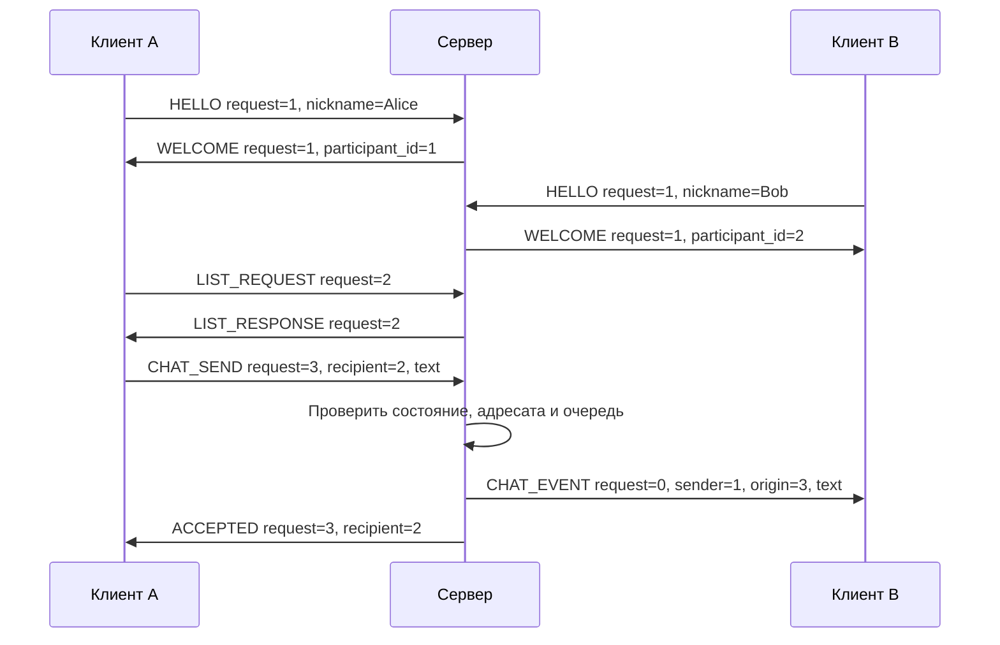

# Протокол TermTalk — WSCK v2

Расширение 0.6.0 повышает версию заголовка до 2. Клиент и сервер обновляются
вместе; существующие команды сохраняют payload и ID, новые описаны ниже.

В 0.7.0 сетевой формат не меняется: подсказки, файловая панель и краткие
/accept /reject — локальные возможности клиента. Команды вызывают те же
FILE_OFFER/DECISION и не добавляют предположений о правах.

## Расширение: статус и файлы

STATUS_REQUEST 0x22: пусто, разрешён до HELLO и в активном сеансе. Ответ
STATUS_RESPONSE 0x23: u16 зарегистрированных участников, u16 настроенная ёмкость
(1..32), u64 лимит одного файла в байтах (0 запрещает файлы); всего 12 байт.
Request echo для запроса; после WELCOME сервер также присылает метаданные
с request=0, без обещания замера RTT. Проба до HELLO не регистрирует участника; после ответа соединение
drain/close. RTT — время запроса/ответа приложения, не ICMP и не измерение полосы.

Файлы: по умолчанию до 32 ГиБ, сервер настраивается от 0 до 1 ТиБ, блок до 4096 байт, имя 1..128 UTF-8 байт без разделителей пути.
По одной передаче на участника, максимум 16 пар при ёмкости 32 (по умолчанию пять). Запросы клиентов
имеют возрастающий request; перенаправленные события — request=0.

| Тип | Значение | Payload |
|---|---|---|
| FILE_OFFER | 0x40 | u32 recipient, u64 size, u16 name length, name |
| FILE_OFFER_EVENT | 0x41 | u32 transfer, u32 sender, u64 size, u16 name length, name |
| FILE_CREATED | 0x42 | u32 transfer, u32 recipient; request предложения |
| FILE_DECISION | 0x43 | u32 transfer, u8 accept (0/1), получатель → сервер |
| FILE_DECISION_EVENT | 0x44 | То же, сервер → отправитель |
| FILE_DATA | 0x45 | u32 transfer, u64 offset, 1..4096 бинарных байт |
| FILE_ACK | 0x46 | u32 transfer, u64 next_offset; подтверждены записанные байты |
| FILE_END | 0x47 | u32 transfer, 32 байта SHA-256 |
| FILE_DONE | 0x48 | u32 transfer; получатель сохранил проверенный файл |
| FILE_CANCEL | 0x49 | u32 transfer, u8 reason (1 отмена, 2 отказ, 3 I/O/очередь, 4 таймер, 5 отключение, 6 checksum) |

Сервер назначает transfer ID, проверяет роли и последовательные offset.
До согласия данные запрещены. В работе только один неподтверждённый блок;
следующий отправляется после FILE_ACK получателя. FILE_END допустим после
подтверждения полного размера. Получатель проверяет SHA-256, закрывает/сбрасывает
временный файл и переименовывает без замены существующего пути, затем FILE_DONE.
Только FILE_DONE подтверждает отправителю завершение. Временный файл создаётся
с CREATE_NEW; при ошибке/отмене удаляется только созданный этим сеансом файл.
Предложение ждёт до 60 с, отсутствие прогресса активной передачи — до 30 с.
Отмена/разрыв освобождают состояние и уведомляют второго участника. Код ERROR=8
означает неверную/занятую передачу. Возобновление и E2EE в этот этап не входят.

Далее описаны общие команды и жизненный цикл WSCK v2.

В 0.5.0 сетевой формат не изменён. `/help`, `/lang`, `/history` и экран входа —
локальные функции клиента; WSH1 — отдельный формат дискового журнала, не кадр WSCK.

Статус: реализованы личный чат, статус и файлы WSCK v2. Кодек, сервер и клиент проверены автоматическими тестами; состав проверки и ограничения — в BUILD-VERIFICATION.md. Версия приложения независима от версии протокола.

## 1. Реализованный обмен

Клиент устанавливает TCP/IPv4-соединение и передаёт HELLO с UTF-8 никнеймом.
После WELCOME получает свой ID и полный список участников. LIST_RESPONSE с
request_id=0 обновляет список при входе/выходе; LIST_REQUEST позволяет запросить
его явно. Сервер передаёт CHAT_EVENT только указанному адресату, а отправителю
возвращает ACCEPTED. Текст не дополняется LF или NUL; границы заданы длиной кадра.

Реализованы HELLO/WELCOME, LIST_REQUEST/LIST_RESPONSE, CHAT_SEND/CHAT_EVENT/ACCEPTED,
PING/PONG, GOODBYE и ERROR. Совместимости с сырым текстовым потоком 0.3.0 нет.

На клиенте `/list` запрашивает список; `/to ID` выбирает собеседника для обычного
ввода; `/msg ID text` отправляет разовое личное сообщение. `/ping` проверяет отклик,
`/quit` посылает GOODBYE, завершает исходящее направление и ждёт закрытия сервера.
EOF stdin также закрывает отправку после уже поставленных кадров. Если сервер
не завершил сеанс после локального shutdown, клиент прекращает ожидание через 5 секунд.

## 2. Почему поверх TCP нужен протокол

TCP даёт упорядоченный поток байтов. Границы вызовов отправителя не являются границами чтения получателя. Это следует из модели [RFC 9293, §2.2](https://www.rfc-editor.org/rfc/rfc9293.html#section-2.2).

```text
отправитель: send("hello")  send("world")
получатель: recv → "hel"; recv → "loworld"
```

Если приложение хочет различать два сообщения, оно должно закодировать границы. Типичные решения:

| Подход | Достоинство | Цена |
|---|---|---|
| Разделитель, например LF | Простая текстовая отладка | Экранирование разделителя внутри текста и бинарных данных |
| Фиксированный размер | Простой разбор | Потери места, неудобные переменные строки |
| Длина перед содержимым | Подходит тексту, файлам и шифртексту | Нужны накопитель и строгая проверка длины |

Используется третий вариант. Протокол описывает синтаксис байтов, допустимость команд в состояниях и смысл ответов. TCP решает транспортную задачу; принадлежность к группе и право отправки проверяет наше приложение.

## 3. Заголовок кадра

Один кадр: 16 байт заголовка, затем `payload_length` байт полезной нагрузки. Все многобайтовые целые — беззнаковые, big-endian. Один байт — 8 бит на целевой Windows.

| Смещение | Размер | Поле | Значение |
|---:|---:|---|---|
| 0 | 4 | `magic` | ASCII `WSCK`, hex `57 53 43 4B` |
| 4 | 1 | `version` | `2` |
| 5 | 1 | `type` | Тип команды/события из таблицы ниже |
| 6 | 2 | `flags` | `0`; ненулевые значения пока недопустимы |
| 8 | 4 | `payload_length` | Размер только полезной нагрузки, без заголовка |
| 12 | 4 | `request_id` | ID запроса либо `0` у самостоятельного события |

`magic` помогает обнаружить ошибочное подключение или несовместимый формат; это не защита от подделки. Версия проверяется до разбора содержимого. Флаги не означают автоматическую поддержку будущих возможностей.

Общий максимум payload реализованных команд — 4108 байт (FILE_DATA с 4096 байтами данных). Прежний проектный резерв 65536 байт не вводится: будущие команды расширяются отдельным согласованным изменением. Для каждого типа действует меньший собственный предел. Нельзя выделять память на произвольную длину, присланную сетью. ProtocolDecoder имеет собственный ограниченный накопитель 4124 байта; размер отдельного recv не определяет размер кадра.

Структуру C напрямую не отправляем: padding, выравнивание и порядок байтов не являются форматом обмена. `#pragma pack` не решает все эти вопросы. Кодек явно записывает числа в массив `unsigned char`, а при чтении использует побайтовые функции либо безопасное копирование в локальное целое с преобразованием порядка байтов. Приведение произвольного указателя сети к `uint32_t *` не требуется.

## 4. Общие правила идентификаторов и строк

ID участника — `u32`, ненулевой, назначается сервером и не переиспользуется до перезапуска сервера. При исчерпании диапазона сервер отклоняет новые регистрации. Перезапуск или переподключение создаёт новую логическую сессию; офлайн-адресации и постоянных аккаунтов пока нет.

Клиентские запросы используют возрастающий ненулевой `request_id` в пределах TCP-соединения. Повторный ID отклоняется; после исчерпания диапазона необходимо переподключение. Ответ содержит ID исходного запроса; самостоятельное событие содержит `0`. Это облегчает сопоставление ответов, но само по себе не обеспечивает долговечную дедупликацию или защиту от атак.

Строки передаются в UTF-8, длины означают байты, не буквы. Завершающий NUL отсутствует. Невалидный UTF-8 и встроенный NUL отклоняются. В строках также запрещены Unicode C1 U+0080..U+009F. В никнейме запрещены ASCII C0-коды (`00`..`1F`) и DEL (`7F`). В сообщении допускаются TAB и LF, остальные C0 и DEL запрещены. UI всё равно должен безопасно отображать текст, не исполняя его как команды терминала.

Никнейм — 1..32 байта; запрещены точные совпадения UTF-8-байтов среди активных участников. `Alice` и `alice` пока различны. Нормализация Unicode и визуально похожие символы требуют отдельного решения; такое сравнение не является проверкой личности.

## 5. Минимальные типы кадров

Обозначение `bytes[n]` означает ровно `n` байт; `rest` — весь остаток payload. Направления: C — клиент, S — сервер.

| Type | Имя | Направление | Payload |
|---|---|---|---|
| `01` | `HELLO` | C → S | `u16 nickname_length`, `bytes[nickname_length] nickname` |
| `02` | `WELCOME` | S → C | `u32 participant_id` |
| `03` | `LIST_REQUEST` | C → S | Пусто |
| `04` | `LIST_RESPONSE` | S → C | Список, описанный ниже |
| `10` | `CHAT_SEND` | C → S | `u32 recipient_id`, `bytes[rest] text` |
| `11` | `CHAT_EVENT` | S → C | `u32 sender_id`, `u32 origin_request_id`, `bytes[rest] text` |
| `12` | `ACCEPTED` | S → C | `u32 recipient_id` |
| `20` | `PING` | C → S | Пусто |
| `21` | `PONG` | S → C | Пусто |
| `22` | `STATUS_REQUEST` | C → S | Пусто, допустим до HELLO |
| `23` | `STATUS_RESPONSE` | S → C | `u16 users`, `u16 capacity`, `u64 max_file_bytes` |
| `30` | `GOODBYE` | C → S | Пусто |
| `7F` | `ERROR` | S → C | `u16 code`, `u16 detail_length`, `bytes[detail_length] detail` |

Коды в таблице записаны шестнадцатерично. Неизвестные типы, включая будущие группы, в версии 2 отклоняются; их формат не подразумевается этой таблицей.

`HELLO` использует ненулевой request ID; `WELCOME` возвращает тот же. `LIST_RESPONSE`, `ACCEPTED`, `PONG` и ошибка команды также возвращают ID запроса. Дополнительно LIST_RESPONSE с request_id=0 автоматически рассылается при изменениях состава; это полный снимок, а не добавление к прежнему списку. `CHAT_EVENT` имеет request ID заголовка `0`; исходный ID отправителя находится в payload и интерпретируется вместе с `sender_id` в пределах текущего запуска сервера.

Payload `LIST_RESPONSE`: `u16 count`, затем `count` записей. Запись: `u32 participant_id`, `u8 status`, `u16 nickname_length`, байты никнейма, 4 байта IPv4 в сетевом порядке и `u16 peer_port`. Статус `1` означает зарегистрированного подключённого участника; других значений пока нет. Список включает запросившего участника и содержит не более настроенной ёмкости (1..32) записей. `peer_port` — порт текущего TCP-подключения клиента, а не обещание доступного P2P-сервиса. Все поля обязаны полностью укладываться в payload, лишние хвостовые байты недопустимы.

Текст `CHAT_SEND` и `CHAT_EVENT` — 1..4096 байт. Отправителя сервер берёт из зарегистрированного соединения: клиент не сообщает произвольный `sender_id`. Отправку самому себе на этом этапе следует отклонять как неверного получателя. ID не заменяет криптографическую аутентификацию: сервер, сеть и клиенты пока считаются доверенным учебным окружением.

`ERROR.detail` ограничено 128 байтами UTF-8; UI принимает решения по числовому коду, а не по тексту. Коды: `1 BAD_STATE`, `2 BAD_PAYLOAD`, `3 NICK_IN_USE`, `4 RECIPIENT_UNAVAILABLE`, `5 QUEUE_FULL`, `6 SERVER_FULL`, `7 BAD_REQUEST_ID`, `8 BAD_TRANSFER` (включая превышение серверного лимита файла). Ошибка без безопасно установленного ID может иметь request ID `0`.

## 6. Жизненный цикл и порядок обмена

Состояния серверного соединения: `WAIT_HELLO`, `ACTIVE`, `CLOSING`, `CLOSED`. До успешного HELLO разрешены HELLO и STATUS_REQUEST; последний завершает анонимное соединение после ответа. Сервер регистрирует участника только после проверки никнейма и возможности поставить WELCOME в очередь. Повторный HELLO в ACTIVE — ошибка состояния. Ошибочный запрос не выполняет бизнес-действие частично.

Срок регистрации — 10 секунд после accept. Неверный или занятый никнейм позволяет повторить HELLO с новым ID в пределах этого срока. Неизвестная версия, неправильный magic, недопустимая длина/тип/flags, нарушение структуры payload или монотонности ID завершают соединение; если безопасно и ресурсно возможно, перед закрытием отправляется ERROR. Обычные ошибки адресата, занятого никнейма или заполненной очереди возвращают ERROR без закрытия.

Сервер настраивает 1..32 участника (по умолчанию 10) и имеет один дополнительный транспортный слот для STATUS/HELLO. При заполненном лимите регистрации HELLO получает SERVER_FULL и завершение. Сверх транспортного лимита новый сокет закрывается сразу. Непрошедшие HELLO занимают слот до своего тайм-аута; дополнительный слот не защищает от перегрузки множеством анонимных соединений. Абсолютный срок сборки неполного кадра — 10 секунд с первого его байта; он не продлевается каждым следующим байтом. Поток с неправильным заголовком или синтаксисом payload закрывается сразу, без обещания ERROR. Нарушение направления команды и не возрастающий request ID получают ERROR и переход в завершение, если ответ помещается в очередь. Команда до HELLO также завершает сеанс с BAD_STATE. Повторный HELLO после регистрации получает BAD_STATE без закрытия.



Стрелки двух последних отправок показывают логический результат постановки в очереди; фактическая доставка по двум TCP-соединениям может происходить в другом порядке. Сервер заранее проверяет место для целого события у получателя и целого подтверждения у отправителя; изменение обеих очередей выполняется без промежуточной ошибки. Если места нет, событие не добавляется и отправитель получает QUEUE_FULL, когда для ответа есть ресурс; иначе закрывается перегруженное соединение по явной политике сервера.

`ACCEPTED` означает только помещение целого события в очередь получателя на сервере. Оно не означает получение, сохранение или прочтение. Получатель может отключиться сразу после этого. Автоматически повторять такой запрос после разрыва нельзя без решения проблемы дублей. Постоянного хранилища, доставки офлайн и гарантии «ровно один раз» нет.

Для будущего статуса «доставлено» нужен отдельный клиентский ACK и проверка, к какому событию он относится. Для «прочитано» — ещё отдельная семантика. Пока такие кадры не определены и не реализуются по догадке.

PING/PONG проверяют обработку запросов приложением, но не доказывают присутствие человека. Интерактивный клиент посылает PING через 3 с после ответа, ждёт до 5 с; просрочка меняет индикатор качества, сама по себе не закрывает сокет. GOODBYE запрещает новые команды и переводит соединение в CLOSING; действует ограниченное ожидание отправки очереди до 3 секунд, после чего соединение закрывается. Потеря соединения без GOODBYE тоже удаляет участника.

## 7. Пример байтов и разбор потока

HELLO с никнеймом `bob`, request ID `1`, payload длиной `5`:

```text
57 53 43 4B  02 01  00 00  00 00 00 05  00 00 00 01
00 03 62 6F 62
```

Никаких пробелов или переводов строк из этого примера по сети не передаётся. Сам кадр состоит из 21 байта. Последние пять байт — длина никнейма и его UTF-8-байты.

Алгоритм кодека:

1. Добавить байты в ограниченный накопитель, не выйдя за его ёмкость.
2. Если меньше 16 байт, ждать ещё.
3. Проверить magic, версию, flags, тип и длину до выделения памяти и вычисления размера кадра.
4. Если payload не полный, ждать ещё в пределах таймера.
5. Разобрать поля без обращения за границы; проверить точную длину и UTF-8.
6. Выдать структурированное событие приложению и убрать кадр из накопителя.
7. Продолжить разбор следующего кадра в пределах бюджета одного прохода.

Нужно различать размер доступной памяти и размер уже принятых данных. Проверку удобно писать как `payload_length <= capacity - header_size` после проверки `capacity >= header_size`, чтобы не получить переполнение сложения. EOF при неполном кадре — оборванный протокол, а не корректное пустое сообщение.

Заимствованный указатель на payload живёт только до изменения накопителя. Приложение либо обрабатывает данные синхронно, либо копирует их в собственное событие/очередь. Нельзя сохранить указатель на локальный буфер recv и использовать после следующего чтения.

## 8. Следующие расширения: группы и E2EE

Для групп понадобятся отдельные команды создания и членства, ID группы и серверная проверка состава при каждой отправке. Полный бинарный формат этих команд будет добавлен перед реализацией; наличие списка участников сейчас не определяет групповые права автоматически.

Файловые кадры и подтверждённый прогресс реализованы в разделе расширения выше. Системное имя/путь отправителя не становится разрешённым путём сохранения на другой машине. Возобновление после разрыва — отдельная функция.

E2EE меняет содержимое кадра: сервер должен видеть достаточные метаданные для маршрутизации, но не ключи расшифрования текста и файлов. Потребуются аутентифицированное шифрование, правила nonce, установление и проверка ключей, защита от повторов и смена групповых ключей. Какие открытые метаданные связываются с шифртекстом как аутентифицируемые дополнительные данные, определим при проектировании криптографического конверта. Сам заголовок с magic и ID ничего не аутентифицирует.

Версия 2 намеренно не резервирует обещанную криптографическую совместимость. При необходимости появится новая версия и явное согласование; незаметно переключаться на открытый текст при ошибке шифрования недопустимо. Учебные реализации алгоритмов проверяются по опубликованным векторам, но это не заменяет анализа всего протокола.

## 9. Кодек и проверка

ProtocolDecoder хранит не более одного полного кадра (4124 байта) без выделения
памяти по сетевой длине. Сначала проверяет 16-байтовый заголовок и допустимый
размер конкретного типа, затем payload. Каждый полный кадр вызывает callback;
неполный хвост остаётся в накопителе. Protocol_Finished отличает чистый EOF от
оборванного кадра. После ошибки декодер не продолжает поток без явного Init.
Внутренний счётчик начал кадров позволяет внешнему таймеру отличить новый
неполный кадр от продолжения старого.

protocol_contract проверяет эталон HELLO, каждый разрез кадра и максимального
сообщения, склейку с хвостом, неверные magic/version/type/flags/длины, строки,
UTF-8, NUL/C0/C1, статусы и дубли ID списка. server_smoke независимо кодирует
и разбирает кадры на Python и проверяет состояния, ID, ошибки адресата,
уникальность никнеймов, переполнение очереди и абсолютные таймеры. chat_smoke
проверяет C-клиент с независимым сервером, включая повреждённые ответы и EOF.

## 10. Транспорт, владение и граница безопасности

ClientState описывает локальное состояние сокета. WAIT_HELLO/ACTIVE/CLOSING —
отдельные логические состояния прикладного ChatPeer. ServerLoop остаётся
единственным владельцем сокетов. Lifecycle OPEN передаёт заимствование в ChatServer,
CLOSE отзывает его до повторного использования слота. Один поток сервера разбирает
кадры и изменяет очереди, что обеспечивает атомарную проверку двух ёмкостей для
личного сообщения. Список содержит только ACTIVE/OPEN-сеансы.

При EOF/GOODBYE участник исключается из новых списков и маршрутизации; уже
поставленный TX отправляется до опустошения или 3-секундного срока. При отсутствии
прогресса TX 5 секунд транспорт закрывает соединение. Переполнение очереди адресата
при личной отправке само по себе не закрывает его: отправитель получает QUEUE_FULL,
событие не ставится. Если ответ самому отправителю не помещается, его соединение
закрывается. При невозможности поставить обязательный снимок списка получатель
также переводится в завершение, не получая частичного кадра.

ID и никнейм не аутентифицируют человека. Сервер берёт sender_id из своего сеанса;
клиент не может задать произвольного отправителя в CHAT_SEND. Маршрутные поля
(sender/recipient/origin request) отделены от текста, но сервер пока видит весь
текст. На сервере нет шифрования, хранения, доставки офлайн или гарантии ровно одного получения.
Локальный клиентский журнал 0.5.0 описан в [UI.md](UI.md) и не добавляет серверных гарантий.
Дальнейшие группы, возобновление файлов и E2EE требуют отдельных задач и при необходимости новой
версии протокола. Граница проверки — BUILD-VERIFICATION.md.

История команд 0.8.0 — локальная функция редактора: ↑/↓ не отправляют кадры,
Enter запускает прежний разбор команды. Формат WSCK v2 и совместимость с 0.6.0
сохранены. Предложения SECURITY-DESIGN.md пока не меняют сетевой протокол.

Подготовка TermTalk 0.9.0: имя/логотип и смена никнейма в отключённом меню
не меняют WSCK v2. Следующий HELLO использует новое имя; переименования
зарегистрированного участника внутри сеанса нет.
