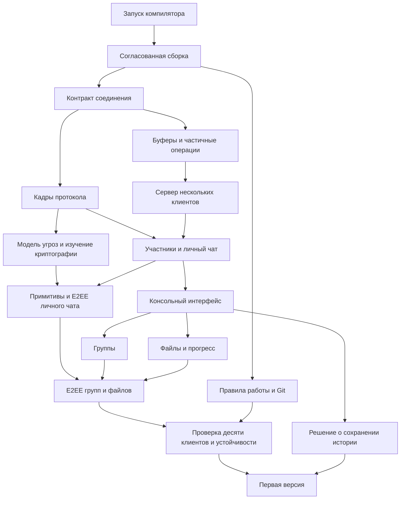

# TermTalk: план разработки

Источник задач — `docs/roadmap.json`. Интерактивная карта в чате показывает снимок этих данных. Она не наблюдает за изменениями исходников автоматически и не меняет JSON при выборе задачи.

## Первая версия

Windows 10/11, один компьютер и локальная сеть, 1..32 одновременно подключённых участника (по умолчанию 10). Отдельные клиент и сервер, C и Windows API без сторонних библиотек. Личные и групповые чаты, консольный интерфейс, файлы и сквозное шифрование. Криптографические алгоритмы реализуются самостоятельно для изучения; статус проверки безопасности описывается отдельно.

Этап «Личный чат» — ранний рабочий результат без шифрования. Полный объём первой версии включает последующие этапы. В 0.6.0 проверена регистрация 32 участников; рост до сотни и нагрузочная производительность требуют отдельных измерений.

## Карта зависимостей

Стрелка означает «необходимо для». Связи отдельных задач находятся в JSON; схема ниже показывает основные ветви.



## Как ведём задачи

- `planned` — запланирована. Если зависимости выполнены, карта показывает «Можно начать»; иначе «Ожидает».
- `in_progress` — реализация начата.
- `review` — реализация подготовлена, проверка ещё не завершена.
- `blocked` — есть конкретное препятствие, описанное в `blocker`.
- `done` — выполнены все критерии приёмки, подтверждение записано в `evidence`.

Зависимость не равнозначна блокеру: ожидание будущей задачи — нормальная часть плана. Не выставляем «Готово» только по факту появления кода. Критерии проверки описываем до реализации; при изменении требований сначала меняем соответствующие задачи и связи.

При работе над проектом в этом чате сверяем затронутые задачи, после изменения кода или получения новых требований обновляем статусы, доказательства и дату в JSON, затем пересоздаём карту. Пересматриваем план на границах этапов. Новые чаты должны сначала прочитать этот файл и JSON; фоновое наблюдение не настроено.

Формат `evidence`: что проверено, какой результат получен и, если есть, ссылка на тест, отчёт или коммит. Ошибки старого компилятора не считаем доказательством ошибок компиляции исходников.

Оценку прогресса считаем по завершённым задачам без весов: это счётчик, а не процент трудозатрат и не прогноз срока. Календарные сроки пока не назначены. Исполнитель задачи выбирается при её взятии: разработчик, ассистент или совместная работа.

## Обновление визуализации

Из корня проекта:

```text
python tools/render_roadmap.py --output <абсолютный-путь-к-визуализации.html>
```

Генератор использует только стандартную библиотеку Python. Python нужен для вспомогательной карты, а не для сборки мессенджера. До записи результата проверяются идентификаторы, статусы, ссылки зависимостей и отсутствие циклов.

Открытые вопросы хранятся в `questions` внутри JSON. В HIST-01 пользователь выбрал
локальную историю с отключением сохранения. Формат, ограничения и приватность
выделены в HIST-02; контракт реализации описан в [UI.md](UI.md).
